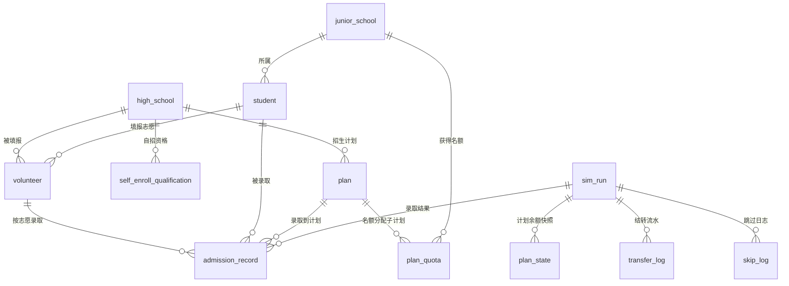

# 02 数据库设计（MySQL 8）

> 与 `sql/schema.sql` 一一对应。改表必须先改这里和 schema.sql，再通知全组。
> 字段为任务书最低要求，允许合理扩展。命名用 snake_case；业务编号用逻辑唯一键，物理主键统一自增 id。

## 1. ER 图

## 2. 表说明

### 2.1 学校（基础数据）

- `junior_school`：初中。字段：学校编号（唯一）、名称。
- `high_school`：高中。字段：学校编号（唯一）、名称、类型（示范性→第三批统招 / 非示范→第四批统招）、统招接收批次、是否有自招资格、是否有名额分配。

### 2.2 考生

- `student`：考生编号（唯一）、虚构姓名、所属初中、总分、同分序号。
- 约束：`(total_score, tie_break_no)` 联合唯一 → 保证"同一总分内序号唯一"（V3）。

### 2.3 招生计划

- `plan`：年度、高中、批次(1-4)、类别（自主招生/名额分配/第三批统招/第四批统招）、初始名额、计划控制线（≥L，默认取 L）。
- `plan_quota`：名额分配子计划，即"高中计划 × 初中 → 名额数"（第二批的竞争单元）。

### 2.4 资格与志愿

- `self_enroll_qualification`：年度、考生、高中、资格状态、考核排名。约束：同一高中内排名唯一（V8）。
- `volunteer`：年度、考生、批次、志愿序号、目标高中。约束：同批次内志愿序号唯一；同批次内同一高中不重复（V4）。

### 2.5 运行与结果

- `sim_run`：运行编号（唯一）、年度、规则参数（L/G₁/Δ）、数据版本、状态、起止时间。
- `plan_state`：**每次运行的计划账本**——初始名额、转入、转出、已录取、剩余。支撑约束④、余额展示（B 做进度界面直接查它）和 T08 结转不叠加校验。
- `admission_record`：运行、考生、高中、计划、批次、志愿序号、投档顺序（录取顺序）、总分、同分序号。约束：`(run_id, student_id)` 唯一 → 数据库层面直接保证约束①（每人每次运行最多录取一次）。
- `transfer_log`：结转流水——来源批次/计划/初中 → 去向计划、名额数、时点。
- `skip_log`：跳过理由、当时余额，用于"解释未录取原因"（结果查询功能）。

## 3. 未录取原因编码（查询功能与日志共用）

| 编码 | 含义 |
| --- | --- |
| BELOW_L | 低于全市最低控制线 L，不参与录取 |
| BELOW_PLAN_LINE | 低于计划控制线 |
| NOT_QUALIFIED | 不在资格名单（自招） |
| QUOTA_FULL | 名额已满 |
| ALREADY_ADMITTED | 前批已录取 |
| NOT_APPLIED | 未填报该计划 |

## 4. 数据生成约定（组员C 对接）

- 生成器输出 SQL 种子文件（`sql/seed-*.sql`）＋ 可选 JSON；必须保存随机种子与生成配置，保证可复现（T12）。
- 小数据集：2 初中、3-4 高中、12-20 考生、每条计划 1-3 人（手工构造，见 docs/03）。
- 大规模演示数据：参考 500 初中 / 150 高中 / 15 万考生（加分项，量力而行）。
- 导入顺序建议：学校 → 计划/子计划 → 考生 → 资格 → 志愿；大批量导入时 `SET FOREIGN_KEY_CHECKS=0`，导入后恢复为 1。
